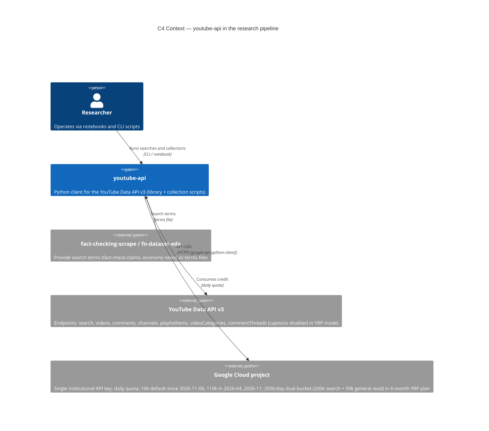
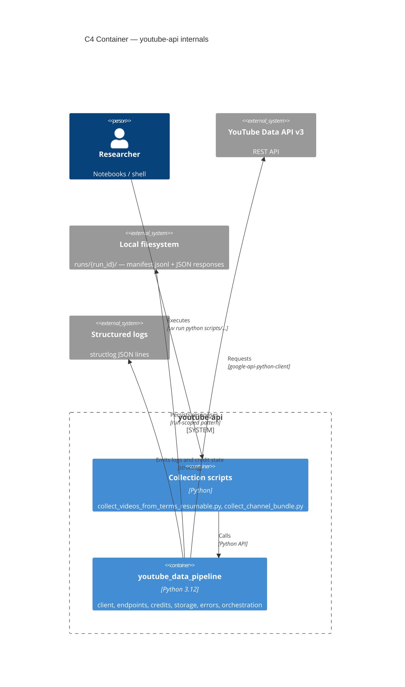

# Architecture — C4 diagrams

C4 diagrams for `youtube-api`, following the [C4 model](https://c4model.com/).
Two levels are documented here: **context** (the library inside the research
pipeline) and **containers** (the library's internal parts). The component
level belongs to `design.md`'s flowchart.

> **Skeleton note:** descriptions below are placeholders — fill them from the
> real behavior of the pipeline (see TODOs at the end).

## 1. Context

## 2. Containers

## 3. Decisions behind this view

Skeleton — move here from `design.md` as ADR-style records (or link to the
dissertation RDPs):

- [ ] Declarative endpoint registry (why not one method per endpoint).
- [ ] Run-scoped storage with manifest (why not a database).
- [ ] Credit accounting per call (limitation: models base cost only).
- [ ] Deterministic error policy (retry / stop / skip).

## TODOs

- [ ] Confirm the upstream systems (which repos actually feed terms files).
- [ ] Confirm quota description against the current Cloud Console caps (Researcher Program participation ended 2026-11-06; default 10k units/day).
- [ ] Add a component-level diagram for `YouTubeDataClient` flow if useful.
- [ ] Decide whether context diagram of the *whole pipeline* (claim → video)
      lives here or in a shared pipeline document.
