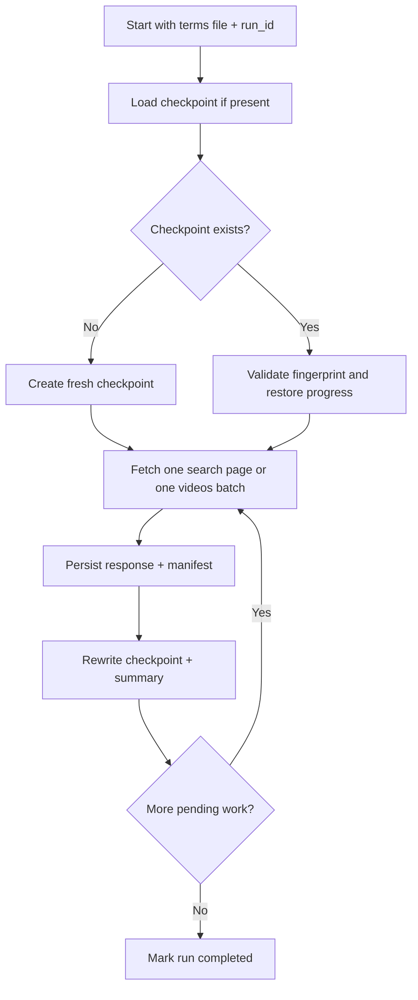

# Bulk Terms Collection

This guide covers two use cases:

1. call the terminal CLI from a notebook;
2. run bulk collection directly in terminal.

## Input format

Create a UTF-8 file with one term per line:

```text
financas comportamentais
macroeconomia brasil
educacao financeira iniciantes
```

Rules used by the script:

- empty lines are ignored;
- lines starting with `#` are ignored;
- duplicate terms are ignored (first occurrence is kept).

## Run in terminal

```bash
uv run python scripts/collect_videos_from_terms_resumable.py \
  --terms-file ./data/terms.txt \
  --run-id my-bulk-run-001 \
  --credit-limit 10000 \
  --search-pages 3 \
  --region-code BR
```

Useful optional flags:

- `--max-terms 50` to test with only the first terms;
- `--compress-responses` to save `.json.gz`;
- `--run-id my-run-001` to force a stable run id and enable resume.

## Resume flow

The resumable CLI uses `--run-id` as the resume key.

1. Start the run with an explicit `--run-id`.
2. Let it stop on `credit_limit`, an interruption, or a manual stop.
3. Re-run the same command with the same `--run-id`.
4. The script reads `terms_collection_checkpoint.json`, skips completed request
   units, and continues only the missing search pages or videos batches.



## Run from notebook

You can call the same CLI from Jupyter with `!`:

```python
%env YOUTUBE_API_KEY=YOUR_API_KEY

!uv run python scripts/collect_videos_from_terms_resumable.py \
  --terms-file ./data/terms.txt \
  --run-id my-bulk-run-001 \
  --credit-limit 10000 \
  --search-pages 3 \
  --region-code BR
```

Alternative via `subprocess`:

```python
import os
import subprocess

env = os.environ.copy()
env["YOUTUBE_API_KEY"] = "YOUR_API_KEY"

subprocess.run(
    [
        "uv",
        "run",
        "python",
        "scripts/collect_videos_from_terms_resumable.py",
        "--terms-file",
        "./data/terms.txt",
        "--run-id",
        "my-bulk-run-001",
        "--credit-limit",
        "10000",
        "--search-pages",
        "3",
        "--region-code",
        "BR",
    ],
    check=True,
    env=env,
)
```

## Output artifacts

For each run, artifacts are written under:

```text
{storage_root}/runs/{run_id}/
```

Main outputs:

- endpoint responses (`search` and `videos`);
- `manifest.jsonl`;
- hashed run log JSONL;
- `terms_collection_summary.json`;
- `terms_collection_checkpoint.json`.

The summary now includes:

- `status`;
- `next_term_index`;
- `resume_supported`;
- `checkpoint_file`.

Notes:

- exact resume is guaranteed for runs started with the resumable CLI;
- legacy runs created by `collect_videos_from_terms.py` can be resumed only when
  all recorded terms were fully completed before the stop.
