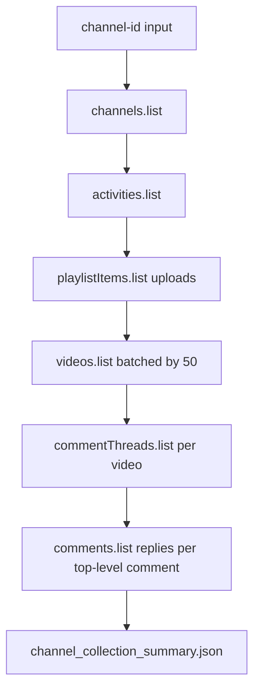

# Channel Collection (by channel ID)

This guide covers collection of a complete channel data bundle with:

1. account data (`channels.list`);
2. post/activity feed (`activities.list`);
3. uploaded videos source (`playlistItems.list` from uploads playlist);
4. video details and metrics (`videos.list`);
5. engagement (`commentThreads.list` + `comments.list` replies).

## Run in terminal

```bash
uv run python scripts/collect_channel_bundle.py \
  --channel-id UC_x5XG1OV2P6uZZ5FSM9Ttw \
  --credit-limit 10000 \
  --activities-pages 5 \
  --activities-max-results 50 \
  --video-pages 10 \
  --max-videos 200 \
  --comment-pages 2 \
  --reply-pages 1
```

## Main parameters

- `--channel-id` (required): channel ID.
- `--api-key`: YouTube API key (or `YOUTUBE_API_KEY` env var).
- `--storage-root`: output root (default `./data/raw`).
- `--run-id`: custom run identifier.
- `--compress-responses`: save payloads as `.json.gz`.
- `--credit-limit`: max credits for the run.
- `--activities-pages`: max activity pages.
- `--activities-max-results`: activity items per page (1-50).
- `--video-pages`: max uploads playlist pages.
- `--max-videos`: max unique videos to detail.
- `--comment-pages`: max comment thread pages per video.
- `--reply-pages`: max reply pages per top-level comment.
- `--summary-name`: summary filename inside the run folder.

## Output artifacts

For each run, data is persisted under:

```text
{storage_root}/runs/{run_id}/
```

Main outputs:

- raw endpoint payloads (`channels`, `activities`, `playlistItems`, `videos`, `commentThreads`, `comments`);
- `manifest.jsonl`;
- run-scoped JSONL logs;
- `channel_collection_summary.json` with aggregated metrics and stop reason.

## Flow diagram



