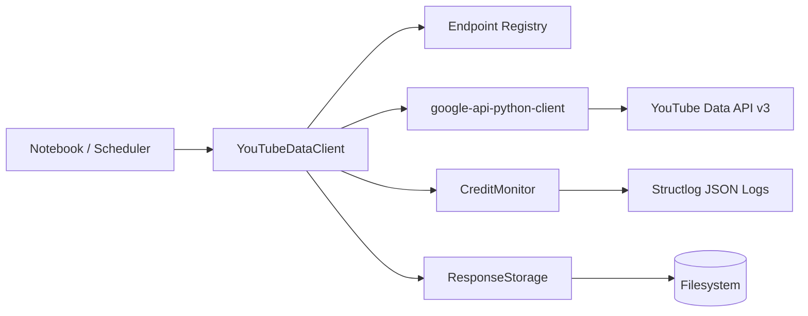

# Design Doc — youtube-data-pipeline

## Overview

The library provides a lightweight layer for collecting from the YouTube Data API v3 with a focus on:

- simplicity for notebooks;
- extensibility for new endpoints;
- credit observability;
- standardized response persistence;
- support for recurring execution.

## Design decisions

### 1) Declarative endpoint registry

Each endpoint is defined by:

- `resource` and `method` from `google-api-python-client`;
- base credit cost;
- required/optional parameters.

This reduces coupling and allows adding new endpoints without changing the client core.

### 2) Single client for collection (`YouTubeDataClient`)

Flow:

1. validates endpoint and parameters;
2. executes request;
3. saves response to disk;
4. accounts for and logs credit cost;
5. advances pagination (when `nextPageToken` is present).

### 3) Run-scoped storage with manifest

Output pattern:

```text
{storage_root}/runs/{run_id}/manifest.jsonl
{storage_root}/runs/{run_id}/endpoint=search/origin=q:HASH/page_001.json
{storage_root}/runs/{run_id}/endpoint=search/origin=q:HASH/page_002.json
...
```

This pattern provides run-level grouping, safer writes, and a machine-friendly index while keeping manual navigation possible.

### 4) Structured logging

`structlog` in JSON to ease integration with observability tools.

### 5) Recurring orchestration

`RecurringCollector` runs any Python job at a fixed interval, sufficient for local cron-like usage, prototyping, and integration with external schedulers.

## Architecture diagram (Mermaid)



## Example endpoint extension

```python
from youtube_data_pipeline.client import YouTubeDataClient
from youtube_data_pipeline.endpoints.definitions import EndpointDefinition

client.register_endpoint(
    EndpointDefinition(
        name="playlistItems",
        resource="playlistItems",
        method="list",
        base_credit_cost=1,
        required_params={"part", "playlistId"},
        optional_params={"maxResults", "pageToken"},
    )
)
```

## Error handling

O cliente utiliza uma política determinística de erro com três ações possíveis:

- retry: erros transitórios com backoff exponencial;
- stop: falhas não recuperáveis (auth, validação, quota, forbidden);
- skip: erros por recurso inexistente/desabilitado, permitindo continuar a pipeline.

As descrições humanas dos erros por endpoint são mantidas em `tipos_de_erro.md` e
usadas para enriquecer logs e artefatos de erro.

## Known limitations

- Credit cost is modeled by the base cost per call (does not account for future policy changes).
