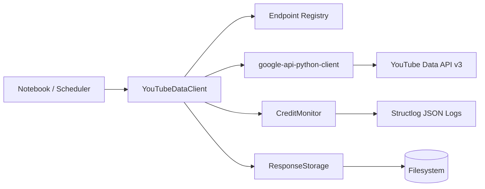

# Design Doc — youtube-data-pipeline

## Visão geral

A biblioteca fornece uma camada leve para coleta da YouTube Data API v3 com foco em:

- simplicidade para notebooks;
- extensibilidade para novos endpoints;
- observabilidade de créditos;
- persistência padronizada de respostas;
- suporte a execução recorrente.

## Decisões de design

### 1) Registro declarativo de endpoints

Cada endpoint é definido por:

- `resource` e `method` da `google-api-python-client`;
- custo-base de crédito;
- parâmetros obrigatórios/opcionais.

Isso reduz acoplamento e permite adicionar novos endpoints sem alterar o núcleo do cliente.

### 2) Cliente único para coleta (`YouTubeDataClient`)

Fluxo:

1. valida endpoint e parâmetros;
2. executa requisição;
3. salva resposta em disco;
4. contabiliza e registra custo de crédito;
5. avança paginação (quando houver `nextPageToken`).

### 3) Armazenamento particionado

Saída no padrão:

```text
{storage_root}/{endpoint}/{timestamp}/response_001.json
{storage_root}/{endpoint}/{timestamp}/response_002.json
...
```

Esse padrão facilita ingestão posterior por jobs de transformação e catálogos de dados.

### 4) Logging estruturado

`structlog` em JSON para facilitar integração com ferramentas de observabilidade.

### 5) Orquestração recorrente

`RecurringCollector` executa qualquer job Python em intervalo fixo, suficiente para cron-like local, prototipagem e integração com agendadores externos.

## Diagrama de arquitetura (Mermaid)



## Exemplo de extensão de endpoint

```python
from youtube_data_pipeline.client import YouTubeDataClient
from youtube_data_pipeline.endpoints.definitions import EndpointDefinition

client.register_endpoint(
    EndpointDefinition(
        name="playlistItems",
        resource="playlistItems",
        method="list",
        base_credit_cost=1,
        required_params={"part", "playlistId"},
        optional_params={"maxResults", "pageToken"},
    )
)
```

## Limitações conhecidas

- O custo de crédito é modelado pelo custo-base por chamada (não contempla variações futuras de política).
- Retry/backoff e tratamento de erros podem ser acoplados na próxima iteração.
