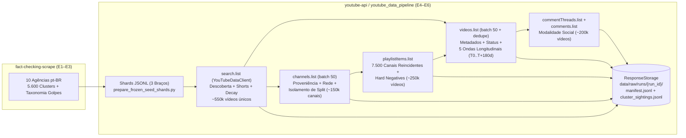

# Plano de Solicitação de Cotas Extras & Implementação — YouTube Researcher Program (YRP)
## Projeto: Maior Conjunto de Dados Multimodal para Detecção de Desinformação e Fraude Financeira (Janela de 6 Meses)
## Repositório Alvo de Implementação: `youtube-api` (`youtube_data_pipeline`)

**Data:** 2026-11-18  
**Horizonte da cota:** **6 meses (180 dias)** — com estrutura pronta para renovação ao final do Mês 6  
**Escopo:** Solicitação discriminada por endpoint na YouTube Data API v3 (via YouTube Researcher Program) e plano de implementação sobre `src/youtube_data_pipeline/`  
**Fronteira entre repositórios:**
- `fact-checking-scrape`: etapas **E1–E3** (scraping das 10 agências pt-BR, filtro de economia/finanças, clusterização de claims e exportação de seeds/queries dos 3 braços).
- `youtube-api` (`youtube-data-pipeline`): etapas **E4–E6** (execução exclusiva da YouTube Data API v3, governança de cota dual-bucket, persistência run-scoped com `manifest.jsonl`, ondas longitudinais e exportação *dehydrated* em compliance estrito com os ToS do YouTube).

**Âncora empírica:** Corpus pt-BR de 10 agências de fact-checking (`52.601` checagens válidas; `5.321` clusters elegíveis de economia/finanças; `5.059` clusters congelados no manifesto `data/processed/frozen_seed_20261107/econ_snapshot_20261107_manifest.json`; piloto real de `3.952` buscas / `58.886` vídeos únicos / `24.203` canais coletados entre 2026-11-08 e 2026-11-18).

---

## 1. Diagnóstico Estratégico: Por que este pedido e sua implementação em `youtube-api` são diferentes

> [!IMPORTANT]
> No ciclo anterior do YRP (vigente entre `2026-04-05` e `2026-11-06` com `110.000` unidades/dia em `youtube-api`) e no pedido anterior de `1M` de unidades/dia no bucket geral, o gargalo real — o endpoint **`search.list`** — não era resolvido, pois `search.list` consome **100 unidades por chamada** e opera com limite restrito separado na YouTube Data API v3. Além disso, como a cota diária **não acumula** (zera à 00h Pacific Time), uma janela de **6 meses** exige um plano de execução mês a mês em `youtube-api` que converta a cota em **ativos científicos irreprodutíveis** (metadados efêmeros pré-remoção, curvas de sobrevivência/*takedown* e *holdout* temporal).

Este plano reestruturado unifica a solicitação ao YRP com a engenharia já consolidada em `youtube-api`:
1. **Discriminação exata por endpoint** (chamadas/dia, unidades/chamada, unidades/dia e volume acumulado em 6 meses), cada número derivado diretamente do piloto empírico e mapeado para o `EndpointDefinition` e `CreditMonitor` de `src/youtube_data_pipeline/`.
2. **Posicionamento científico de alto impacto (Compliance-First):** estruturar o **maior benchmark multimodal do mundo no domínio de desinformação e fraude financeira** (~800k vídeos descobertos, ~200k com reação social), superando em ordem de grandeza benchmarks existentes (FakeSV ~3,6k vídeos; FVC ~380 vídeos), **persistindo exclusivamente metadados da API e IDs** (sem jamais baixar vídeo/áudio ou usar `yt-dlp`, conforme regra inegociável de `CLAUDE.md`).
3. **Sinalização explícita de eficiência de cota já suportada por `youtube_data_pipeline`:** batching máximo de 50 IDs/chamada em `videos.list` (com deduplicação global `seen_video_ids` já implementada em `scripts/collect_videos_from_terms_resumable.py`) e `channels.list`, substituição de buscas por `playlistItems.list` (100× mais barato, já utilizado em `scripts/collect_channel_bundle.py`) para canais reincidentes, e **desativação explícita** de `captions.list` (50 unidades) no perfil YRP.

---

## 2. Arquitetura do Dataset Multimodal e Fluxo em `youtube-api`

O projeto integra **5 dimensões de sinais multimodais e longitudinais** ancoradas em eventos financeiros verificados (10 agências de checagem pt-BR) + taxonomia ativa de golpes financeiros *in-the-wild* (incluindo YouTube Shorts), operando 100% sobre payloads oficiais da YouTube Data API v3:

### As 5 Dimensões do Dataset (em Estrito Compliance com os ToS em `youtube-api`)

> [!CAUTION]
> **Regra Inegociável do `youtube-api` (`CLAUDE.md`):** Este repositório **apenas persiste metadados JSON da YouTube Data API v3 e IDs** (`data/raw/runs/{run_id}/`). É terminantemente proibido baixar vídeos, áudios, frames, thumbnails ou transcrições, ou integrar `yt-dlp`. Qualquer inspeção audiovisual ocorre por anotadores humanos assistindo ao vídeo incorporado na plataforma (`watched_video=1`) ou sob protocolo aprovado no vault (`notas/metodologia/multimodalidade-sem-violacao-termos-de-uso.md`).

| Dimensão / Modalidade | Fonte via `youtube_data_pipeline` | Papel na Detecção Financeira (Metadados & Sinais) |
| :--- | :--- | :--- |
| **1. Texto & Metadados Estruturados** | `videos.list` (`part=snippet,contentDetails,statistics,status,topicDetails`) + claims verificados | Títulos clickbait, descrições com links de golpe/WhatsApp/Telegram, tags, categorias e entidades financeiras (PIX, INSS, Receita Federal, bancos, cripto). |
| **2. Metadados Visuais & Formatos** | `videos.list` (`snippet.thumbnails`, `contentDetails.definition`, `dimension`, `duration`) | Resolução/aspect ratio (identificação de Shorts ≤60s e vídeos ≤300s), disponibilidade de thumbnails de alta resolução e metadados para auditoria visual na interface de anotação. |
| **3. Sinais de Áudio & Legenda (Metadados)** | `videos.list` (`contentDetails.caption`, `snippet.defaultAudioLanguage`, `defaultLanguage`) | Sinalização de presença de legenda (`true`/`false`) ao custo de `0,02` unid./vídeo (**sem chamar `captions.list` nem `captions.download`**) e idioma do áudio para triagem de vídeos elegíveis à anotação humana (`watched_video=1`). |
| **4. Reação Social (Comentários)** | `commentThreads.list` (`part=snippet,replies`) + `comments.list` (`part=snippet`) | Relatos de vítimas ("é golpe", "perdi dinheiro"), desmentidos comunitários e sinais de amplificação coordenada (bots), com `authorChannelId` pseudonimizado na camada analítica. |
| **5. Rede & Dinâmica Temporal** | `channels.list` + `playlistItems.list` + 5 ondas longitudinais de `videos.list` | Reincidência de canais, curvas de viralização, *time-to-takedown* (detecção via ausência de ID no retorno do batch de 50 de `videos.list` / `status.privacyStatus`) e isolamento estrito de canais nos splits treino/teste. |

### Escala Alvo em 6 Meses (Funil de Dados)
- **Pool de descoberta (`search.list` + `playlistItems.list`):** **~800.000 vídeos únicos** (`~550.000` via busca nos 3 braços + golpes *in-the-wild*/Shorts + `~250.000` de canais reincidentes e controles *hard negative* do mesmo canal).
- **Rede de produtores (`channels.list`):** **~150.000 canais únicos**, auditados em T0, Mês 3 e Mês 6.
- **Corpus enriquecido com reação social:** **~200.000 vídeos** filtrados por idioma (`pt`), duração e domínio financeiro (com re-amostragem longitudinal de comentários em subamostra de 30k vídeos).
- **Benchmark Ouro/Prata anotado + Holdout Temporal:** expansão estruturada em ondas (conforme `fact-checking-scrape/docs/relatorio-expansao-10x-econ-fakenews.md`), com anotação humana independente assistindo ao vídeo (`watched_video=1`, 2 anotadores + adjudicação, `κ LB ≥ 0,60`), splits agrupados por `claim_cluster_id`/canal e **holdout temporal disjunto (Meses 5–6)**.

---

## 3. Evidência Empírica do Piloto e Artefatos Existentes em `youtube-api`

Os volumes solicitados derivam diretamente de duas âncoras já presentes nos repositórios:
1. **Fila congelada em `youtube-api` (`data/processed/frozen_seed_20261107/econ_snapshot_20261107_manifest.json`):** `5.059` clusters ativos (`5.773` itens cobertos) + `433` clusters já coletados anteriormente (`5.492` clusters mapeados, expandindo para `~5.600` com as coletas diárias de `scripts/collect_videos_from_daily_factchecks.py`).
2. **Coleta piloto real executada entre 2026-11-08 e 2026-11-18:**
   - **Queries executadas (braço `propagacao`, 1 página/query):** `3.952`
   - **Pares vídeo-query retornados:** `68.263` (**17,3 vídeos/query** em média geral)
   - **Vídeos únicos descobertos:** `58.886` (**14,9 vídeos únicos/chamada**)
   - **Canais únicos descobertos:** `24.203` (razão inicial `0,41` canal/vídeo)
   - **Clusters ativos (≥1 vídeo):** `2.792` (média `24,45` vídeos/cluster; mediana `17,0`; **percentil 75 = `50,0`**)

> [!NOTE]
> O fato de **p75 = 50,0** (teto exato de 1 página da API) prova empiricamente que **mais de 25% dos clusters financeiros ativos estão sendo truncados** quando limitados a 1 página, justificando tecnicamente o padrão `--search-pages 3` já implementado em `scripts/collect_videos_from_terms_resumable.py` (com parada adaptativa imediata quando `nextPageToken` é `None`).

---

## 4. Tabela Discriminada de Cotas por Endpoint (Janela de 6 Meses)

Todos os custos seguem a tabela oficial da **YouTube Data API v3** e estão mapeados em `src/youtube_data_pipeline/endpoints/definitions.py`. Inclui margem operacional de **~5–10%** para retentativas de erros transitórios (`HTTP 5xx`/timeout via `RetryPolicy` em `errors.py`) e variação de volume semanal.

### 4.1 Resumo Executivo por Endpoint (6 Meses / 180 Dias)

| Endpoint (YouTube Data API v3) | Registro em `definitions.py` | Custo / Chamada | Itens / Chamada | Pico Diário (Chamadas/dia) | Pico Diário (Unidades/dia) | Volume Total 6 Meses (Chamadas) | Volume Total 6 Meses (Unidades) | Finalidade Científica & Script em `youtube-api` |
| :--- | :---: | :---: | :---: | :---: | :---: | :---: | :---: | :--- |
| **`search.list`** *(bucket restrito)* | `DEFAULT_ENDPOINTS["search"]` | **100** | até 50 vídeos | **2.000** | **200.000** | **65.000** | **6.500.000** | Backfill 3 braços (`propagacao`, `combate`, `neutra`), golpes *in-the-wild*/Shorts, decay longitudinal, fatia comparativa e holdout (`collect_videos_from_terms_resumable.py` + `collect_videos_from_daily_factchecks.py`). |
| **`videos.list`** | `DEFAULT_ENDPOINTS["videos"]` | **1** | até 50 vídeos (batch) | **4.000** | **4.000** | **105.000** | **105.000** | Enriquecimento T0 (~800k vídeos deduplicados) + 5 ondas longitudinais (T+7d, T+30d, T+60d, T+120d, T+180d) de engajamento e *takedowns*. |
| **`channels.list`** | `DEFAULT_ENDPOINTS["channels"]` | **1** | até 50 canais (batch) | **1.000** | **1.000** | **10.000** | **10.000** | Proveniência de ~150k canais únicos (`uploads_playlist_id`, estatísticas, status) + auditoria de banimento/remoção em M3 e M6. |
| **`playlistItems.list`** | Promoção para `DEFAULT_ENDPOINTS["playlistItems"]` | **1** | até 50 vídeos | **2.000** | **2.000** | **41.000** | **41.000** | Monitoramento de 7.500 canais reincidentes e controles *hard negative* sem gastar `search.list` (economia de 100×). |
| **`commentThreads.list`** | `DEFAULT_ENDPOINTS["commentThreads"]` | **1** | até 100 threads | **20.000** | **20.000** | **687.500** | **687.500** | Modalidade social em ~200k vídeos filtrados + re-amostragem longitudinal (30k vídeos) e holdout M6 (20k vídeos). |
| **`comments.list`** | `DEFAULT_ENDPOINTS["comments"]` | **1** | até 100 respostas | **8.000** | **8.000** | **220.000** | **220.000** | Cadeias de respostas em threads ativas de debate/desmentido (~40k vídeos de maior engajamento × ~5 threads). |
| **`videoCategories.list`** | Novo em `DEFAULT_ENDPOINTS["videoCategories"]` | **1** | lista fixa | **< 10** *(única)* | **< 10** | **10** | **10** | Mapeamento de categorias BR/comparativo (cacheado em `data/raw/runs/`). |
| **SUBTOTAL — `search.list`** | Bucket `search_list` | — | — | **2.000** | **200.000** | **65.000** | **6.500.000** | Bucket dedicado de busca no `CreditMonitor`. |
| **SUBTOTAL — Leituras Gerais** | Bucket `general_read` | — | — | **35.000** *(teto 50k)* | **35.000** *(teto 50k)* | **1.063.510** | **1.063.510** | Bucket geral de leitura (batching otimizado de 50 IDs). |
| **TOTAL SOLICITADO (com buffer)** | Dual-Bucket (`CreditMonitor`) | — | — | **37.000** | **250.000** *(200k search + 50k geral)* | **1.128.510** | **7.563.510** | **Teto diário: 250.000 unidades/dia por 180 dias.** |

### 4.2 Endpoints Explicitamente NÃO Solicitados / Bloqueados no Perfil YRP
- **`captions.list` (50 unidades/chamada):** **0 chamadas.** Embora exista em `DEFAULT_ENDPOINTS["captions"]` para retrocompatibilidade da biblioteca, o perfil YRP desabilita sua execução. A disponibilidade de legenda é lida via `videos.list` (`contentDetails.caption`) ao custo efetivo de **0,02 unidade/vídeo** (2.500× mais eficiente).
- **`captions.download` (200 unidades/chamada):** **0 chamadas** (não registrado em `definitions.py`, restrito a proprietários dos vídeos e proibido pelas diretrizes de ToS do repositório).
- **`activities.list` (1 unidade/chamada):** **0 chamadas na campanha YRP** (usado apenas no script avulso `collect_channel_bundle.py`; substituído em larga escala por `playlistItems.list` sobre a playlist `uploads` do canal, que retorna diretamente todos os `videoId`s enviados).
- **Endpoints de escrita (`*.insert`, `*.update`, `*.delete`):** **0 chamadas** (`EndpointDefinition.method` é fixo em `"list"`).

---

## 5. Memória de Cálculo Detalhada (6 Meses)

1. **`search.list` (`65.000` chamadas / `6.500.000` unidades):**
   - **M1 — Backfill histórico (3 braços):** `5.600 clusters × 3 braços = 16.800 queries` × `2,2 páginas adaptativas` = **36.960 chamadas** *(nota: 3.952 páginas 1 do braço `propagacao` já coletadas no piloto são aproveitadas via bootstrap de checkpoint, servindo como folga extra para clusters que saturam 3 páginas)*.
   - **M3–M6 — Golpes financeiros *in-the-wild* + Shorts:** `400 arquétipos/queries × 2 faixas de duração (videoDuration=short + medium) × 3 páginas × 4 ciclos mensais` = **9.600 chamadas**.
   - **M4 — Decay longitudinal de busca:** `1.500 clusters ativos × 3 checkpoints (T+7d, T+30d, T+90d) × 1 página` = **4.500 chamadas**.
   - **M5 — Fatia comparativa cross-market (ES-LATAM / EN) ou expansão de eventos agudos pt-BR:** `3.000 queries × 2 páginas` = **6.000 chamadas**.
   - **M1–M6 — Checagens diárias/semanais contínuas (`collect_videos_from_daily_factchecks.py`) + Holdout Temporal M6:** `(15 clusters/sem × 26 sem × 3 braços × 2 pág = 2.340)` + `2.600 holdout M6` = **4.940 chamadas**.
   - **Subtotal + ~5% margem:** `62.000 → 65.000 chamadas` (pico **2.000 chamadas/dia**).

2. **`videos.list` (`105.000` chamadas / `105.000` unidades):**
   - **População alvo:** até `800.000 vídeos únicos` (`~550k` busca + `~250k` `playlistItems.list`), garantidos sem duplicata intra-run por `--dedupe-video-details` (`seen_video_ids`).
   - **T0 + 5 ondas longitudinais (T+7d, T+30d, T+60d, T+120d, T+180d):** `6 × (800.000 / 50) = 96.000 chamadas` → `+10% margem = 105.000 chamadas` (pico **4.000 chamadas/dia**).

3. **`channels.list` (`10.000` chamadas / `10.000` unidades):**
   - **População alvo:** `~150.000 canais únicos` extraídos de `snippet.channelId` dos vídeos descobertos.
   - **T0 + auditoria M3 + auditoria final M6:** `3 × (150.000 / 50) = 9.000 chamadas` → `+10% margem = 10.000 chamadas` (pico **1.000 chamadas/dia**).

4. **`playlistItems.list` (`41.000` chamadas / `41.000` unidades):**
   - **M2 — Backfill de canais reincidentes e controles *hard negative*:** `7.500 canais × 3 páginas (até 150 vídeos/canal via uploads_playlist_id) = 22.500 chamadas`.
   - **M4 e M6 — Atualizações bimestrais (2 ondas × 1 página incremental):** `7.500 × 2 = 15.000 chamadas`.
   - **Subtotal + ~10% margem:** `37.500 → 41.000 chamadas` (pico **2.000 chamadas/dia**).

5. **`commentThreads.list` (`687.500` chamadas / `687.500` unidades):**
   - **M2–M3 — Corpus multimodal filtrado:** `200.000 vídeos × 2,5 páginas médias (maxResults=100) = 500.000 chamadas`.
   - **M5–M6 — Re-amostragem longitudinal (30k vídeos) + holdout M6 (20k vídeos):** `50.000 × 2,5 = 125.000 chamadas`.
   - **Subtotal + 10% margem:** `625.000 → 687.500 chamadas` (pico **20.000 chamadas/dia**).

6. **`comments.list` (`220.000` chamadas / `220.000` unidades):**
   - **Respostas em threads ativas (`totalReplyCount > 0`):** `40.000 vídeos de maior engajamento × 5 threads ativas × 1 página (maxResults=100) = 200.000 chamadas` → `+10% margem = 220.000 chamadas` (pico **8.000 chamadas/dia**).

---

## 6. Plano de Implementação e Adaptação Técnica em `youtube-api`

Em vez de construir um cliente paralelo em outro repositório, toda a execução da campanha YRP aproveita a arquitetura já testada de `youtube-api` (`YouTubeDataClient`, `ResponseStorage`, `CreditMonitor`, `RetryPolicy`, `manifest.jsonl` e `terms_collection_checkpoint.json`), exigindo apenas **extensões incrementais e retrocompatíveis**.

### 6.1 O que já está pronto em `youtube-api` (Reuso Direto)
- **Cliente HTTP thread-safe com retry/backoff e catálogo de erros:** `src/youtube_data_pipeline/client.py` + `errors.py` (`RetryPolicy` com backoff exponencial em `429/500/503`, `ErrorAction.SKIP` automático para `commentsDisabled`, `videoNotFound`, `channelNotFound`, e `ErrorAction.STOP` para `quotaExceeded`).
- **Persistência run-scoped atômica e auditável:** `src/youtube_data_pipeline/storage.py` grava cada página em `{storage_root}/runs/{run_id}/endpoint={ep}/origin={field}:{hash}/page_{idx:03d}.json(.gz)` e indexa todas as chamadas e erros em `manifest.jsonl`.
- **Coletor retomável por termos e shards estruturados (`.jsonl`):** `scripts/collect_videos_from_terms_resumable.py` já suporta `TermSpec` estruturado (`claim_cluster_id`, `representative_item_id`, `item_ids`, `rank`, `agency_id`, `published_after`, `published_before`), deduplicação global de `videos.list` (`--dedupe-video-details`), paginação adaptativa e geração de `cluster_sightings.jsonl`.
- **Gerador de shards congelados e unificador de runs:** `scripts/prepare_frozen_seed_shards.py` e `scripts/unify_runs.py` (`--disjoint-shards`).
- **Coleta diária automatizada via systemd/cron:** `scripts/collect_videos_from_daily_factchecks.py` + `scripts/run_daily_youtube_collect.sh`.

### 6.2 Extensões no Core `src/youtube_data_pipeline/`

1. **`src/youtube_data_pipeline/endpoints/definitions.py`:**
   - Promover `playlistItems` (hoje registrado localmente em `scripts/collect_channel_bundle.py`) para `DEFAULT_ENDPOINTS["playlistItems"]` (`required_params={"part", "playlistId"}`, `optional_params={"id", "maxResults", "pageToken", "videoId"}`, `base_credit_cost=1`).
   - Adicionar `videoCategories` em `DEFAULT_ENDPOINTS["videoCategories"]` (`required_params={"part"}`, `optional_params={"id", "regionCode", "hl"}`, `base_credit_cost=1`).
   - Expandir `optional_params` nos endpoints existentes para cobrir 100% da campanha YRP:
     - `search`: adicionar `"order"`, `"safeSearch"`, `"eventType"`.
     - `videos`: garantir `"hl"` (além de `"id"`, `"chart"`, `"maxResults"`, `"pageToken"`, `"regionCode"`).
     - `commentThreads`: adicionar `"order"`, `"textFormat"`, `"searchTerms"`, `"moderationStatus"`.
     - `comments`: adicionar `"textFormat"`.

2. **`src/youtube_data_pipeline/credits.py` + `client.py` (Suporte a Dual-Bucket e Teto por Endpoint):**
   - Estender `CreditMonitor` (mantendo compatibilidade total com `credit_limit: int | None` em `client.fetch()`) para suportar **limites separados por bucket** (`search_credit_limit: int | None = 200_000` para `search` vs `general_credit_limit: int | None = 50_000` para `videos`, `channels`, `playlistItems`, `commentThreads`, `comments`, `videoCategories`) e tetos opcionais de chamadas por endpoint (`per_endpoint_call_limits: dict[str, int]`).
   - Ajustar o default de `count_failed_requests` ou permitir `failed_request_credit_cost: int = 1` no perfil YRP: quando `search.list` falha com erro HTTP, o `CreditMonitor` pode registrar `1` unidade (custo administrativo real no GCP) em vez de `100` unidades, evitando subutilizar o bucket de busca por falsos débitos de 100 unidades em erros transitórios.
   - Adicionar utilitário de janela diária em **Pacific Time (`ZoneInfo("America/Los_Angeles")`)** para reconciliação exata com o reset diário do Google Cloud Console.

3. **`src/youtube_data_pipeline/config.py`:**
   - Manter `YOUTUBE_API_KEY` como variável padrão do `.env` (conforme `CLAUDE.md` e `run_daily_youtube_collect.sh`), aceitando `YOUTUBE_YRP_API_KEY` como fallback/alias institucional, sempre apontando para **um único Google Cloud Project** (zero rotação de chaves).
   - Adicionar flag `allow_endpoints: frozenset[str] | None` (no modo YRP, bloqueia `captions` preventivamente).

### 6.3 Novos Scripts e Adaptações em `scripts/`

1. **Adaptação de `scripts/prepare_frozen_seed_shards.py` e `scripts/collect_videos_from_terms_resumable.py` (Mês 1, Mês 3, Mês 4, Mês 5):**
   - Estender `TermSpec` em `collect_videos_from_terms_resumable.py` com campos opcionais retrocompatíveis:
     - `arm: str | None = None` (`"propagacao"`, `"combate"`, `"neutra"`, `"scam_in_the_wild"`, `"cross_market"`)
     - `query_id: str | None = None`
     - `video_duration: str | None = None` (`"short"`, `"medium"`, `"any"` — essencial para a campanha de Shorts no Mês 3)
     - `wave_type: str | None = None` (`"backfill"`, `"decay_t7"`, `"decay_t30"`, `"decay_t90"`, `"holdout_m6"`)
   - Incluir `arm`, `query_id`, `video_duration` e `wave_type` em `cluster_sightings.jsonl` e em `build_search_origin()`, permitindo que os 3 braços do mesmo `claim_cluster_id` coexistam ou rodem em runs dedicadas (`econ_yrp_m1_propagacao`, `econ_yrp_m1_combate`, `econ_yrp_m1_neutra`) sem colisão de `dedupe_key`.

2. **Novo script `scripts/import_pilot_to_resumable_run.py` (Bootstrap dos `58.886` vídeos do piloto):**
   - Lê as `3.952` respostas já coletadas no piloto (`fact-checking-scrape/data/runs/youtube_collection/*/search_responses.jsonl`) e converte para um diretório de run padrão do `youtube-api` (`data/raw/runs/yrp_pilot_propagacao_p1/`), gerando `manifest.jsonl`, `cluster_sightings.jsonl` (`68.263` sightings) e `terms_collection_checkpoint.json` (`seen_video_ids` com `58.886` vídeos únicos).
   - Permite:
     1. Enriquecer imediatamente os `58.886` vídeos do piloto com `videos.list` (apenas `1.178` chamadas = `1.178` unidades!) e os `24.203` canais com `channels.list` (`485` chamadas = `485` unidades!) já no Dia 1;
     2. Retomar a paginação (páginas 2 e 3) apenas para os clusters cujo payload da página 1 continha `nextPageToken`, economizando `3.952` chamadas (`395.200` unidades) de `search.list`.

3. **Novo script `scripts/collect_longitudinal_waves.py` (Ondas T0..T+180d de `videos.list` e M3/M6 de `channels.list`):**
   - Lê os `seen_video_ids` e `cluster_sightings.jsonl` das runs de descoberta em `data/raw/runs/`, agenda e executa varreduras em lotes estritos de 50 IDs (`videos.list` com `part=snippet,contentDetails,statistics,status,topicDetails` e `channels.list` com `part=snippet,statistics,contentDetails,status,topicDetails`).
   - **Detecção explícita de *takedowns* e banimentos:** compara os 50 IDs solicitados no parâmetro `id` com os `items[].id` retornados no payload salvo no run; os IDs ausentes são registrados em `takedowns_ledger.jsonl` com `(video_id/channel_id, wave, detected_at_utc, run_id, request_id)`.

4. **Novo script `scripts/collect_recidivist_channels_playlists.py` (Mês 2, Mês 4, Mês 6 — `playlistItems.list`):**
   - Seleciona os `7.500` canais de maior recorrência em clusters financeiros + canais de controle pareados a partir dos runs de `channels.list` (usando `contentDetails.relatedPlaylists.uploads`), coleta até 3 páginas (`150` vídeos/canal) no Mês 2 e 1 página incremental nos Meses 4 e 6, e resolve metadados dos novos vídeos via `videos.list` (batch 50).

5. **Novo script `scripts/collect_comments_resumable.py` (Meses 2–6 — `commentThreads.list` + `comments.list`):**
   - Opera sobre a lista de `~200.000` vídeos elegíveis (filtrados a partir dos runs de `videos.list` onde `statistics.commentCount > 0` e idioma `pt`), com checkpoint atômico (`comments_collection_checkpoint.json`), coletando até `--comment-pages` (média `2,5` páginas, `maxResults=100`, `order=relevance`) e encadeando `comments.list` (`parentId`) para threads com `totalReplyCount > 0` nos `~40.000` vídeos de maior engajamento.
   - Respeita `ErrorAction.SKIP` nativo de `errors.py` quando um vídeo retorna `commentsDisabled` ou `videoNotFound`.

6. **Novo script `scripts/export_yrp_dehydrated.py` (Governança, LGPD e Release Pública):**
   - Consolida os runs de `data/raw/runs/` gerando:
     - **Tabelas analíticas internas** (com `authorChannelId` pseudonimizado via `HMAC-SHA256` com salt local em `.env`);
     - **Artefato público *dehydrated*** contendo exclusivamente `(video_id, channel_id, comment_id, claim_cluster_id, query_id, arm, wave, split, annotation_labels)` e filtrando vídeos removidos/indisponíveis (`is_available == False`), em estrita conformidade com os ToS do YRP e `CLAUDE.md`.

---

## 7. Cronograma de Aproveitamento Máximo (Mês 1 ao Mês 6) em `youtube-api`

| Período | Foco Principal | Scripts & Endpoints em `youtube-api` | Entregável Científico |
| :--- | :--- | :--- | :--- |
| **Mês 1** *(Dias 1–30)* | **Bootstrap do piloto + Backfill dos 3 braços** | `import_pilot_to_resumable_run.py`, `collect_videos_from_terms_resumable.py` (`search`, `videos`), `collect_longitudinal_waves.py` (`channels`) | Pool base (~450k vídeos, ~120k canais) com proveniência total (`claim_cluster_id`, `arm`, `page`, `rank_in_page`) em `cluster_sightings.jsonl` + snapshot T0. |
| **Mês 2** *(Dias 31–60)* | **Rede de canais, *Hard Negatives* e Comentários** | `collect_recidivist_channels_playlists.py` (`playlistItems`, `videos`), `collect_comments_resumable.py` (`commentThreads`, `comments`) | +250k vídeos de controle *within-channel* + reação social + congelamento de splits sem vazamento de canal. |
| **Mês 3** *(Dias 61–90)* | **Golpes Financeiros *In-the-Wild* + Shorts** | `collect_videos_from_terms_resumable.py` (`videoDuration=short` e `medium`), `collect_longitudinal_waves.py` (auditoria M3 de `channels`) | Expansão para fraudes financeiras fora das agências de checagem (PIX, INSS, cripto, deepfakes em Shorts). |
| **Mês 4** *(Dias 91–120)* | **Estudo Longitudinal de Viralidade & *Takedowns*** | `collect_longitudinal_waves.py` (ondas T+7d..T+120d de `videos`), `collect_videos_from_terms_resumable.py` (decay de `search`), `collect_recidivist_channels_playlists.py` | Curvas irreprodutíveis de *time-to-takedown* (`takedowns_ledger.jsonl`), engajamento pré-remoção e *decay* algorítmico de busca. |
| **Mês 5** *(Dias 121–150)* | **Fatia Comparativa (ES/EN) ou Deep-Dive pt-BR** | `collect_videos_from_terms_resumable.py`, `collect_comments_resumable.py` (re-amostragem longitudinal de 30k vídeos) | Generalização cross-market/multilíngue e evolução longitudinal de comentários/moderação. |
| **Mês 6** *(Dias 151–180)* | **Holdout Temporal, Auditoria & Renovação** | `collect_videos_from_daily_factchecks.py` (holdout M5–M6), `collect_longitudinal_waves.py` (T+180d), `export_yrp_dehydrated.py` | Split *out-of-time* rigoroso, base *dehydrated* em compliance e relatório de consumo via `manifest.jsonl` para renovação de +6 meses no YRP. |

### Regras Operacionais de Ouro na Janela de 6 Meses
1. **Efêmero primeiro:** diariamente (após o reset das 00:00 PT), priorizar o enriquecimento `videos.list` T0 dos vídeos recém-descobertos (inclusive os de `collect_videos_from_daily_factchecks.py`) e as ondas longitudinais vencidas antes do backfill histórico — golpes financeiros sofrem *takedown* rapidamente.
2. **Trilha de auditoria imutável (`CLAUDE.md`):** nunca apagar diretórios em `data/raw/runs/{run_id}/`. Cada requisição fica registrada em `manifest.jsonl` com `request_id`, `origin_hash`, `params_hash`, `cost` e `per_endpoint`, servindo como prova criptográfica de uso responsável da cota perante o YRP.
3. **Zero download de mídia:** toda a coleta de 180 dias persiste exclusivamente JSONs da API (com `--compress-responses` `.json.gz` habilitado para runs de comentários e ondas longitudinais).

---

## 8. Checklist Crítico de Compliance e Auditoria (Antes de Submeter e ao Ativar a Chave)

> [!CAUTION]
> **Desativação definitiva do coletor multi-chave legado:** Durante o período sem cota do YRP (após `2026-11-06`), o script legado `fact-checking-scrape/scripts/collect_youtube_propagation.py` utilizou rotação de chaves. **NUNCA mencione rotação de múltiplas chaves no formulário do YRP** — isso viola os Termos de Serviço da YouTube API. Com a reestruturação para `youtube-api`, toda a coleta passa a rodar exclusivamente sobre `YouTubeDataClient` com **uma única chave (`YOUTUBE_API_KEY`) vinculada a um único Google Cloud Project institucional**.

- [ ] **Projeto GCP único e institucional:** configurado em `youtube-api/.env` (`YOUTUBE_API_KEY`), criado sob e-mail acadêmico (`.edu` / `.br` universitário) do orientador(a)/PI ou laboratório.
- [ ] **Restrição inegociável de ToS (`CLAUDE.md`):** persistir apenas metadados da API e IDs; zero download de vídeo/áudio/frames/thumbnails; zero chamadas a `captions.list` ou `captions.download`.
- [ ] **Política de compartilhamento (*Dehydration*):** declarar explicitamente que qualquer distribuição pública do benchmark (`scripts/export_yrp_dehydrated.py`) conterá **apenas IDs (`video_id`, `channel_id`, `comment_id`) e rótulos/anotações científicas**, respeitando exclusões de conteúdo (`takedowns_ledger.jsonl`).
- [ ] **Proteção de dados pessoais (LGPD / IRB):** pseudonimização/hashing (`HMAC-SHA256`) de identificadores de autores de comentários (`authorChannelId`) ao gerar tabelas analíticas; zero tentativa de reidentificação.
- [ ] **Rate limiting, backoff exponencial e checkpoint atômico:** garantidos nativamente por `RetryPolicy` (`src/youtube_data_pipeline/errors.py`), `CreditMonitor` (`credits.py`) e `terms_collection_checkpoint.json`.
- [ ] **Atualização documental em `youtube-api`:** ao receber a aprovação do YRP, atualizar a nota de quota em `CLAUDE.md`, `docs/metodologia_busca_youtube.md` e `docs/architecture/c4.md` (registrando a nova janela de `250.000` unidades/dia: `200k` search + `50k` leitura geral).

---

## 9. Rascunho Pronto para o Formulário do YRP (Inglês — 6-Month Quota Justification)

Você pode adaptar e colar o texto abaixo diretamente na seção *"API Quota Justification & Endpoint Breakdown"* do YouTube Researcher Program (já alinhado às práticas de compliance e à arquitetura do `youtube-data-pipeline`):

> **Project Overview & Scientific Contribution**  
> We are constructing a large-scale, rigorously curated multimodal benchmark dataset for **financial misinformation and scam detection** in Brazilian Portuguese (*pt-BR*, with a controlled comparative slice), anchored on 52,601 verified fact-checks from 10 accredited Brazilian fact-checking organizations (5,321 eligible economy/finance claim clusters already frozen, expanding to ~5,600+ clusters plus an active in-the-wild financial scam taxonomy covering PIX/banking fraud, fake social security/INSS benefits, fraudulent investments, and deepfake endorsements in both standard videos and YouTube Shorts).
>
> **Empirical Grounding & Quota-Efficient Engineering (`youtube-data-pipeline`)**  
> A controlled pilot on 3,952 propagation queries (capped at 1 page / 50 results) retrieved 58,886 unique videos across 24,203 channels, with over 25% of active clusters saturating the 50-result first-page ceiling (`p75 = 50.0`). To scale responsibly while minimizing API footprint, our open-source collection library (`youtube-data-pipeline`) operates strictly **read-only** from a **single institutional Google Cloud Project**, persists only API metadata and resource IDs in full compliance with YouTube Terms of Service (never downloading video/audio streams), and implements:
> 1. **Maximum batching (50 IDs/request) with global run-level deduplication** for `videos.list` and `channels.list`;
> 2. **100× quota reduction** via `playlistItems.list` (1 unit/50 videos) instead of `search.list` (100 units) when monitoring recidivist channels and collecting within-channel hard-negative controls;
> 3. **Zero calls** to high-cost/restricted endpoints (`captions.list`, `captions.download`, or write methods); caption availability is read via `videos.list` (`contentDetails.caption`) at 0.02 units/video;
> 4. **Adaptive pagination** (terminating immediately when `nextPageToken` is absent), atomic per-request checkpointing (`manifest.jsonl`), and deterministic error handling (skipping disabled comments or deleted resources without retrying, and applying exponential backoff with jitter on transient `HTTP 429`/`5xx` errors).
>
> **Itemized Endpoint Quota Request (6-Month / 180-Day Research Window)**  
> We request a total daily quota of **250,000 units/day** for **6 months**, explicitly partitioned into **200,000 units/day (2,000 calls/day) for `search.list`** and **50,000 units/day for general read endpoints**:
> - **`search.list` (100 units/call):** Peak **2,000 calls/day** (200,000 units/day) | 6-month total: **65,000 calls** (6,500,000 units). Covers Month 1 historical backfill across 5,600 financial claim clusters × 3 balanced arms (propagation, debunking, neutral control; ~2.2 adaptive pages = 36,960 calls), Months 3–6 in-the-wild financial scam & Shorts discovery (9,600 calls), Month 4 longitudinal search-rank decay re-queries (4,500 calls), Month 5 comparative cross-market slice (6,000 calls), and ongoing daily/weekly fact-checks + Month 6 out-of-time temporal holdout (4,940 calls), plus ~5% retry margin.
> - **`videos.list` (1 unit/call, 50 IDs/call):** Peak **4,000 calls/day** (4,000 units/day) | 6-month total: **105,000 calls** (105,000 units). Covers T0 metadata enrichment and 5 longitudinal engagement/takedown sweeps (T+7d, T+30d, T+60d, T+120d, T+180d) across up to ~800,000 unique candidate videos.
> - **`channels.list` (1 unit/call, 50 IDs/call):** Peak **1,000 calls/day** (1,000 units/day) | 6-month total: **10,000 calls** (10,000 units). Covers ~150,000 unique channels at T0, Month 3, and Month 6 (channel-level provenance, split isolation, and ban/takedown auditing).
> - **`playlistItems.list` (1 unit/call, 50 items/call):** Peak **2,000 calls/day** (2,000 units/day) | 6-month total: **41,000 calls** (41,000 units). Covers 7,500 high-recurrence and matched control channels (3 pages backfill in Month 2 + 2 bi-monthly 1-page incremental refreshes in Months 4 and 6) for within-channel hard negatives.
> - **`commentThreads.list` (1 unit/call, 100 items/call):** Peak **20,000 calls/day** (20,000 units/day) | 6-month total: **687,500 calls** (687,500 units). Covers social-reaction analysis on ~200,000 filtered videos (~2.5 adaptive pages) plus longitudinal comment re-sampling (30,000 videos) and Month 6 temporal holdout (20,000 videos).
> - **`comments.list` (1 unit/call, 100 items/call):** Peak **8,000 calls/day** (8,000 units/day) | 6-month total: **220,000 calls** (220,000 units). Covers threaded reply chains on active debunking/warning threads across ~40,000 high-engagement videos.
>
> **6-Month Execution Schedule & Data Governance**  
> Months 1–2 complete historical discovery, channel controls, and social context; Month 3 expands to in-the-wild financial scams and Shorts; Months 4–5 execute longitudinal survival/takedown tracking and comparative evaluation; Month 6 freezes an out-of-time temporal holdout and performs final compliance auditing. All collected API metadata will be stored securely on institutional infrastructure for non-commercial academic research, commenter identifiers will be pseudonymized via cryptographic hashing, and any public benchmark release will be strictly **dehydrated** (IDs and researcher-generated annotations only), honoring content deletions and YouTube Researcher Program Terms of Service.
